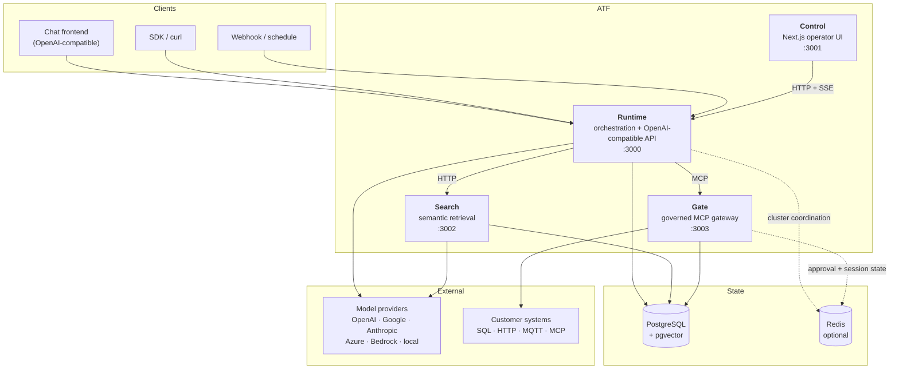
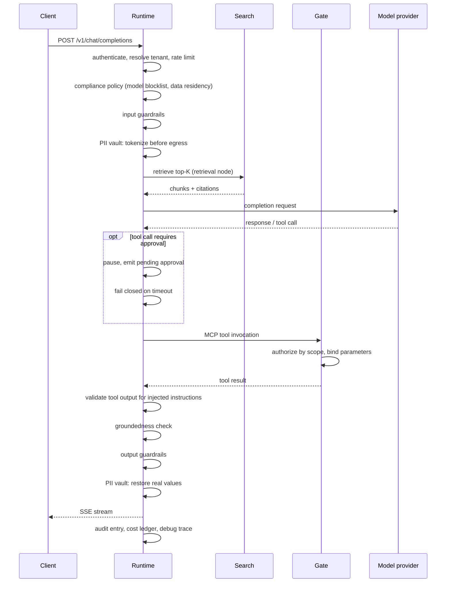

# Architecture

ATF is a Bun workspace monorepo containing four independently deployable applications and
five shared contract packages. The applications communicate over documented HTTP and MCP
interfaces only. None imports another's source, and none reads another's private
configuration.

## System overview

Solid lines show configured request or persistence paths; they are not all mandatory for every
deployment or flow. Dashed lines are explicitly optional coordination paths. Runtime can run
without Search, Gate, or PostgreSQL for flows that do not require those capabilities, with
in-memory/per-replica trade-offs described below. Without Redis, Runtime and Gate degrade to
per-replica coordination rather than failing.

## Applications

### Runtime (`apps/runtime`)

The orchestration engine and the only public entry point for AI traffic. Bun + Hono.

Executes flow graphs, resolves models through named provider instances, enforces guardrails,
policy, approvals, and the PII vault, and records cost, traces, and audit entries. Exposes an
OpenAI-compatible surface so existing clients work unchanged, plus administrative and
monitoring APIs for Control.

Route groups: `/v1/*` (OpenAI-compatible chat, responses, models, embeddings), `/flows/*`,
`/runs/*`, `/admin/*`, `/monitoring/*`, `/security/*`, `/eval/*`, `/triggers/*`,
`/webhooks/*`, `/mcp`, `/health/*`, `/metrics`.

### Control (`apps/control`)

The operator and governance interface. Next.js 16, React 19.

Control uses Runtime's HTTP API and SSE monitoring stream. Its Next.js server delivers the
web application and optional response headers, but it imports no Runtime source and holds no
provider or database credentials. Production browser calls use relative same-origin URLs by
default and require deployment-owned reverse-proxy routing; an explicit
`NEXT_PUBLIC_BACKEND_URL` is a build-time development/cross-origin override. Control can be
deployed separately, behind a different ingress, or omitted entirely.

### Search (`apps/search`)

Semantic and hybrid retrieval over PostgreSQL with pgvector. Bun or Node, Express.

Owns ingestion, chunking, embedding, indexing, and query. Fuses dense and full-text results
with RRF and optionally reranks. Exposes REST endpoints (`/documents`, `/collections`,
`/summary`, `/folders`, `/admin/stats`), an MCP endpoint at `/mcp`, an OpenAPI document at
`/openapi.json`, `/metrics`, and `/health`.

Search is the one application with a Node build target (`build:node`) in addition to the Bun
target, for deployments that require a Node runtime.

### Gate (`apps/gate`)

An MCP gateway that turns declarative YAML into governed tools. Bun, Express.

Configuration comes from `MCPGATE_CONFIG_DIR`, not from environment variables alone. Each
tool declares its backend (SQL through Knex, HTTP, MQTT, MCP proxy, webhook, or a composite),
its parameter schema, and the scopes required to invoke it. User input is always bound as a
parameter; the verified caller identity flows into the query so a tool returns only rows that
caller may see.

Serves both MCP transports — streamable HTTP at `mcpPath` (default `/mcp`) and the legacy SSE
pair `/sse` and `/messages` — plus `/healthz`, `/readyz`, and a monitoring surface under
`/monitor/*`.

## Shared contract packages

`packages/` holds the messages that cross service boundaries, each as a versioned package
with Zod validation and its own tests.

| Package | Version | Contract |
| --- | --- | --- |
| `@atf/identity-contract` | 1.1.0 | Verified principal and identity compatibility records |
| `@atf/transaction-contract` | 1.1.0 | Transaction envelope compatibility records |
| `@atf/evidence-contract` | 1.1.0 | Evidence and lineage compatibility records |
| `@atf/schema-compatibility` | 1.0.0 | Deterministic schema-evolution classification |
| `@atf/contract-adapter` | 1.0.0 | Explicit adapters between the contracts above |

`integration/system` exercises their combined lifecycle without external infrastructure, which
is what makes a contract break visible in CI rather than at deployment time.

### Contract boundary status

Runtime, Search, and Gate still carry protocol-specific transaction and evidence envelopes
where their wire protocols genuinely differ. Those local envelopes are **not** aliases of the
shared records. Converging them requires an explicit compatibility migration through
`@atf/contract-adapter`; assuming they are already identical is the mistake this note exists
to prevent.

## Request path

A chat request through Runtime:

Stages are independently configured and many governance features are opt-in. The sequence above
shows the ordering when those controls are enabled: policy admission precedes graph execution,
PII tokenization precedes provider calls, and restoration follows output checks. A missing or
invalid `compliance-policy.yaml` currently disables that policy and allows execution; the
policy's `failClosed` field applies to evaluator exceptions only. Deployments that depend on the
policy must validate and monitor that it is loaded.

## State

**PostgreSQL**, when configured, is the durable store. Runtime uses it for the cost ledger,
audit log, jobs, approvals, tenants, and checkpoints; Search requires PostgreSQL/pgvector for
documents, chunks, and vector indexes. Runtime's tenant isolation combines application query
scoping with optional database row-level security. Enforced RLS requires the guided
`rls-setup --confirm` onboarding, `TENANT_RLS_ENABLED=true`, a least-privilege application
connection, and a separate `DATABASE_OPERATOR_URL` for privileged cross-tenant work.

**Redis** is optional and used only for coordination that must span replicas: pending
approvals, distributed rate limits, cluster-wide budgets, and Gate's transport session state.
Absent Redis, each feature degrades to per-replica scope with a documented trade-off rather
than blocking. Multi-replica deployments that rely on any of those behaviors need it.

## Toolchain

Bun 1.4.0 is the repository toolchain, the task runner, and the runtime for Bun-native
services. Node.js 26 is the single supported Node major and the runtime for Node-backed
artifacts. TypeScript 7.0.2 is pinned as a workspace dependency. There is no separate build
orchestrator; Bun workspaces and `--filter` provide it.

## Design rules

These are enforced in review and, where possible, in tests:

1. **Contracts over shared code.** Cross-service messages live in a contract package. An
   application never imports another application's source.
2. **Fail-closed boundaries are explicit.** Authentication, authorization, approvals, and
   configured policy checks deny on the failure modes documented for them. Exceptions are also
   explicit: no/invalid compliance-policy file disables that policy, PII detector failures
   default to open unless configured otherwise, and optional state can degrade to per-replica
   behavior. A path must not be called fail-closed without its configuration and fallback being
   stated.
3. **Configuration is validated at startup.** Runtime parses the environment declared in its
   Zod `EnvSchema` and exits with the full list of problems rather than failing at first use.
   Provider references are resolved and checked at boot. A few subsystems that accept an
   injectable environment record — the agent transaction fabric, the Rocket.Chat connect flow —
   read their own names outside the schema and validate at the point of use instead;
   [docs/CONFIGURATION.md](docs/CONFIGURATION.md) marks those explicitly. New variables belong
   in the schema.
4. **Declarative over inferred.** Data classes, approval requirements, and tool authorization
   are declared, not guessed from request content, because a misclassification would either
   leak or block real traffic.
5. **Degradation is designed.** Every optional dependency has a defined fallback and a stated
   trade-off; see ADR 0002.
6. **Evidence is verifiable when enabled.** Configured audit entries are hash-chained and
   configured evidence bundles are signed, so those records can be checked rather than merely
   trusted. Enabling the mechanisms does not by itself establish regulatory compliance.

## Further reading

- [docs/CAPABILITIES.md](docs/CAPABILITIES.md) — what each subsystem does
- [docs/CONFIGURATION.md](docs/CONFIGURATION.md) — every environment variable
- [docs/adr/](docs/adr/) — the decisions behind the rules above, with their trade-offs
- [DEPLOYMENT.md](DEPLOYMENT.md) — production requirements
- [DEVELOPMENT.md](DEVELOPMENT.md) — working in this repository
