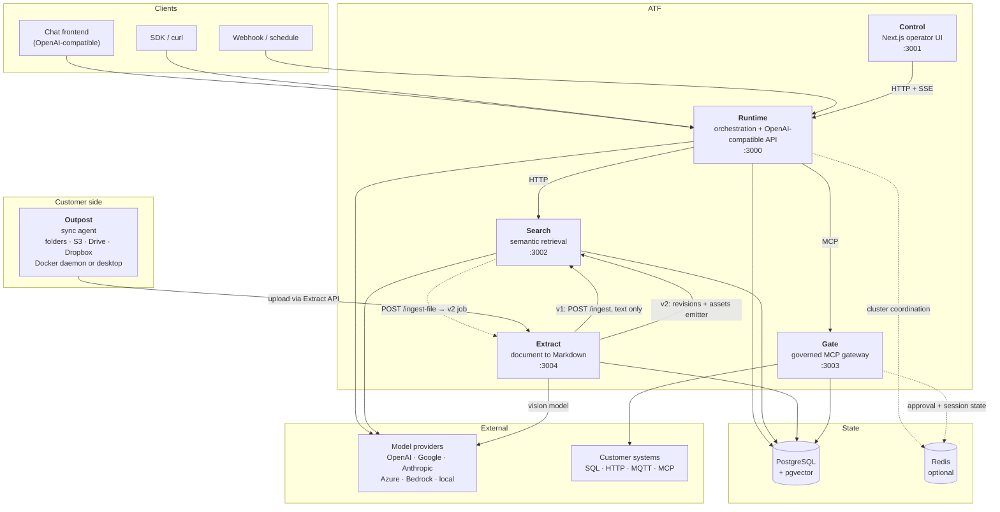
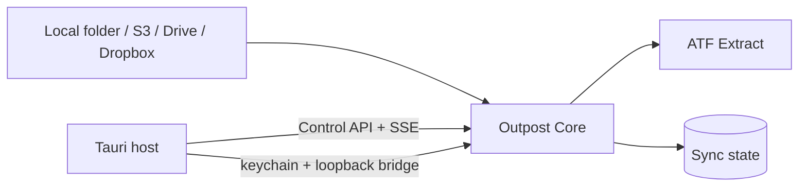
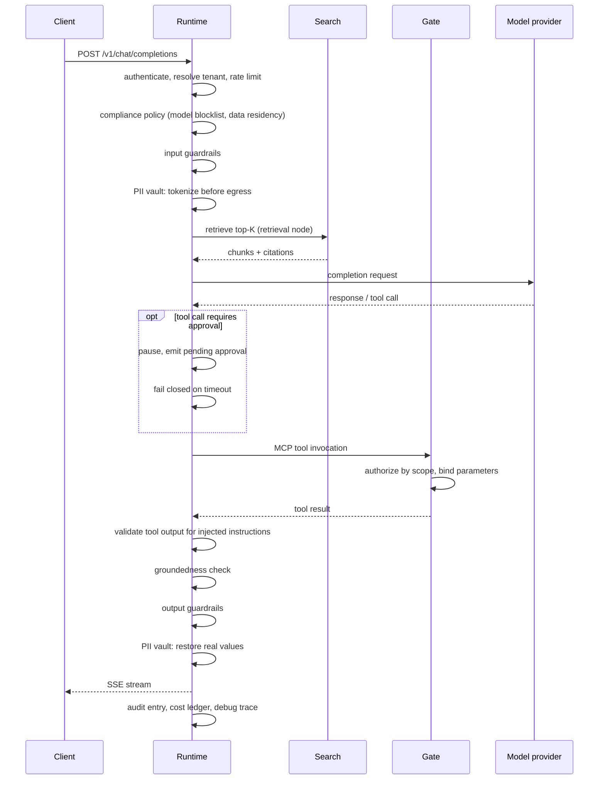
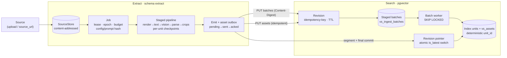

# Architecture

ATF is a Bun workspace monorepo containing seven independently deployable applications and
twelve shared packages — seven versioned contract packages plus `security-kit`, `observability`,
`outpost-core`, `canonical-json` and `mcp-2026`. The applications communicate over documented HTTP and MCP interfaces
only. None imports another's source, and none reads another's private configuration. Five
applications form the server footprint (Runtime, Control, Search, Gate, Extract); the two
Outpost applications run on the customer side and reach the platform through Extract's API.

## System overview

Solid lines show configured request or persistence paths; they are not all mandatory for every
deployment or flow. Dashed lines are explicitly optional coordination paths. Runtime can run
without Search, Gate, or PostgreSQL for flows that do not require those capabilities, with
in-memory/per-replica trade-offs described below. Without Redis, Runtime and Gate degrade to
per-replica coordination rather than failing; Search and Extract keep per-process rate limits, and
in production refuse to start with `REPLICAS` > 1 and no `RATE_LIMIT_REDIS_URL`. Extract is optional in both directions: Search
mounts `/ingest-file` only when `CONVERTER_URL` is set, and Extract mounts `/v1/ingest` only
when `SEARCH_URL` is set. Extract's own PostgreSQL connection (`EXTRACT_DATABASE_URL`, schema
`extract`) is likewise optional: it is what turns on the persistent v2 job path — resumable
uploads, durable jobs, and the emitter — and when it is absent Extract falls back to the
original in-process synchronous conversion. The v2 data flow is described in
[Document Intelligence v2](#document-intelligence-v2-data-flow) below.

### Extract Outpost

The Outpost is a locally operated sync agent around `@atf/outpost-core`. Its Docker runtime
uses `/data` for sync state and file-backed credentials, while the Tauri desktop runtime keeps
credentials in the OS keychain and communicates with the same Node SEA sidecar over a local
Bearer-token-protected Control API. The sidecar binds only to loopback, reports its ephemeral
port on stdout and keeps OAuth loopback handling and keychain operations in the native host.

## Applications

### Runtime (`apps/runtime`)

The orchestration engine and the only public entry point for AI traffic. Bun + Hono.

Executes flow graphs, resolves models through named provider instances, enforces guardrails,
policy, approvals, and the PII vault, and records cost, traces, and audit entries. Exposes an
OpenAI-compatible surface so existing clients work unchanged, plus administrative and
monitoring APIs for Control.

Route groups (generated from the router tree — do not edit by hand):

<!-- BEGIN GENERATED: runtime route groups (bun run route-reference) -->
Updated with `bun run route-reference` from the real router tree
(`src/bootstrap/routes-inference.ts`, `routes-management.ts`, `autopilot.ts`).
Conditional groups are mounted only when their bootstrap condition holds.

| Router group | Mount | Enabled when | Endpoints |
| --- | --- | --- | --- |
| `createAnalysisArtifactsRouter` | — (full paths) | always | POST `/v1/analysis-artifacts` GET `/v1/analysis-artifacts` GET `/v1/analysis-artifacts/:id` POST `/v1/analysis-artifacts/:id/revisions` |
| `createHealthRouter` | — (full paths) | always | GET `/health` GET `/health/live` GET `/health/ready` |
| `createTransactionJwksRouter` | — (full paths) | always | GET `/.well-known/atf-transaction-jwks.json` |
| `createModelsRouter` | — (full paths) | always | GET `/v1/models` GET `/v1/models/:id` |
| `createMediaRouter` | — (full paths) | always | GET `/v1/media/:id` |
| `createChatRouter` | — (full paths) | always | POST `/v1/chat/completions` |
| `createResponsesRouter` | — (full paths) | always | POST `/v1/responses` |
| `createJobsRouter` | — (full paths) | `jobStore is set` | GET `/v1/jobs/:id` |
| `createReceiptsRouter` | — (full paths) | `receiptsEnabled && receiptStore is set` | GET `/v1/receipts` GET `/v1/receipts/:id` GET `/v1/receipts/:id/proof` |
| `createReceiptJwksRouter` | — (full paths) | `receiptsEnabled && receiptStore is set` | GET `/.well-known/atf-receipt-jwks.json` |
| `createEvidenceJwksRouter` | — (full paths) | `evidenceKey is set || erasureJwksKey is set` | GET `/.well-known/atf-evidence-jwks.json` |
| `createAtfJwksRouter` | — (full paths) | always | GET `/.well-known/atf-jwks.json` |
| `createFlowMcpRouter` | — (full paths) | always | ALL `/mcp` |
| `createRedTeamRouter` | — (full paths) | always | POST `/security/red-team/:flowId/run` GET `/security/red-team/runs` GET `/security/red-team/runs/:runId` GET `/security/red-team/posture` GET `/security/red-team/attacks` POST `/security/red-team/attacks/refresh` POST `/security/red-team/attacks/register` GET `/security/tool-authz` PUT `/security/tool-authz` GET `/security/mcp` |
| `createRagRouter` | — (full paths) | `vectorStore is set && ragEmbedder is set` | POST `/v1/rag/:collection/documents` DELETE `/v1/rag/:collection/documents` DELETE `/v1/rag/:collection` GET `/v1/rag/collections` GET `/v1/rag/:collection/count` GET `/v1/rag/:collection/documents` |
| `createMemoryRouter` | — (full paths) | `memoryStore is set` | POST `/v1/memory` POST `/v1/memory/recall` DELETE `/v1/memory` GET `/v1/memory/count` GET `/admin/memory/sessions` GET `/admin/memory/sessions/:id` DELETE `/admin/memory/sessions/:id` |
| `createAssistantsRouter` | — (full paths) | `assistantsResult is set` | GET `/v1/assistants` POST `/v1/assistants` GET `/v1/assistants/:id` PATCH `/v1/assistants/:id` GET `/v1/assistants/:id/sessions` POST `/v1/assistants/:id/sessions/:conversationId/fork` DELETE `/v1/assistants/:id/sessions/:conversationId` POST `/v1/assistants/:id/sessions/:conversationId/restore` GET `/v1/assistants/:id/sessions/:conversationId/snapshots` POST `/v1/assistants/:id/sessions/:conversationId/snapshots` GET `/v1/assistants/:id/tool-recovery` POST `/v1/assistants/:id/tool-recovery/:conversationId/:toolCallId/reconcile` GET `/v1/assistants/:id/sessions/search` GET `/v1/assistants/:id/runs` POST `/v1/assistants/:id/runs` GET `/v1/assistants/:id/runs/:runId` GET `/v1/assistants/:id/schedules` POST `/v1/assistants/:id/schedules` DELETE `/v1/assistants/:id/schedules/:scheduleId` PATCH `/v1/assistants/:id/directives` GET `/v1/assistants/:id/soul/history` GET `/v1/assistants/:id/skills` PUT `/v1/assistants/:id/skills` DELETE `/v1/assistants/:id/skills/:name` POST `/v1/assistants/:id/skills/:name/publish` GET `/v1/org-skills` POST `/v1/org-skills/:orgSkillId/install` GET `/v1/assistants/:id/proposals` POST `/v1/assistants/:id/proposals/:proposalId/apply` POST `/v1/assistants/:id/proposals/:proposalId/reject` POST `/v1/assistants/:id/delegation` GET `/v1/assistants/:id/delegation` DELETE `/v1/assistants/:id/delegation` GET `/v1/assistants/:id/channels/rocketchat` PUT `/v1/assistants/:id/channels/rocketchat` DELETE `/v1/assistants/:id/channels/rocketchat` GET `/v1/assistants/:id/channels` POST `/v1/assistants/:id/channels` DELETE `/v1/assistants/:id/channels/:grantId` GET `/v1/assistants/:id/inbox` |
| `createAssistantsAdminRouter` | — (full paths) | `assistantsResult is set` | GET `/admin/assistants` GET `/admin/identity-broker/delegations` GET `/admin/org-skills` POST `/admin/org-skills/:orgSkillId/deprecate` GET `/admin/assistants/:tenantId/:userId/:id` PATCH `/admin/assistants/:tenantId/:userId/:id/constraints` PATCH `/admin/assistants/:tenantId/:userId/:id` GET `/admin/assistants/:tenantId/:userId/:id/proposals` |
| `createGitopsRouter` | — (full paths) | `gitopsEnabled` | POST `/webhooks/git` GET `/webhooks/git` |
| `createProviderKeysRouter` | — (full paths) | always | GET `/admin/provider-keys` |
| `createProviderMonitoringRouter` | — (full paths) | always | GET `/monitoring/providers` |
| `createProviderTestingRouter` | — (full paths) | always | GET `/monitoring/providers/:name/models` POST `/monitoring/providers/test/prompt` POST `/monitoring/providers/test/capabilities` POST `/monitoring/providers/test/performance` |
| `createGuardrailsRouter` | — (full paths) | always | GET `/admin/guardrails` |
| `createPiiVaultRouter` | — (full paths) | always | GET `/admin/pii-vault/status` |
| `createEvalRouter` | — (full paths) | always | GET `/eval/cases` POST `/eval/cases` DELETE `/eval/cases/:id` |
| `createTenantsRouter` | — (full paths) | `tenantManagementEnabled` | POST `/admin/tenants` GET `/admin/tenants` GET `/admin/tenants/:id` PATCH `/admin/tenants/:id` DELETE `/admin/tenants/:id` POST `/admin/tenants/:id/keys` GET `/admin/tenants/:id/keys` DELETE `/admin/tenants/:id/keys/:kid` GET `/admin/tenants/:id/usage` GET `/admin/tenants/:id/usage/summary` GET `/admin/tenants/:id/usage/export` GET `/admin/tenants/:id/provider-keys` PUT `/admin/tenants/:id/provider-keys/:provider` DELETE `/admin/tenants/:id/provider-keys/:provider` |
| `createControlRouter` | — (full paths) | always | GET `/monitoring/approvals` GET `/monitoring/approvals/:id/widget` GET `/monitoring/approvals/:id/decide` POST `/monitoring/approvals/:id` POST `/monitoring/replay` GET `/monitoring/canary` |
| `createMcpRouter` | — (full paths) | `mcpServers.length > 0` | GET `/mcp/servers` POST `/mcp/:server/reconnect` |
| `createOptimizerRouter` | `/optimizer` | always | GET `/optimizer/routing-advice` POST `/optimizer/routing-advice` POST `/optimizer/analyze/:executionId` POST `/optimizer/:flowId/run` GET `/optimizer/:flowId/runs` GET `/optimizer/runs/:runId` POST `/optimizer/runs/:runId/promote` |
| `createCompliancePolicyRouter` | `/admin/compliance-policy` | always | GET `/admin/compliance-policy/` POST `/admin/compliance-policy/evaluate` GET `/admin/compliance-policy/report` GET `/admin/compliance-policy/report.csv` |
| `createPolicyReplayRouter` | `/admin/policy-replay` | always | POST `/admin/policy-replay/` POST `/admin/policy-replay/stream` |
| `createEvalRunsRouter` | — (full paths) | always | POST `/admin/eval/matrix-runs` GET `/admin/eval/matrix-runs` GET `/admin/eval/matrix-runs/:id` GET `/admin/eval/matrix-runs/:runId/cells/:cellId/trace` POST `/admin/eval/runs` GET `/admin/eval/runs` |
| `createComplianceRouter` | — (full paths) | `retentionService is set` | GET `/admin/compliance/status` POST `/admin/compliance/sweep` POST `/admin/compliance/forget` POST `/admin/compliance/erasures/:id/retry` GET `/admin/compliance/dossier` GET `/admin/compliance/audit-anchor` POST `/admin/compliance/audit-anchor` GET `/admin/compliance/ropa` GET `/v1/me/data` DELETE `/v1/me/data` GET `/v1/me/data/erasures/:id` |
| `createFlowsRouter` | — (full paths) | always | GET `/flows` GET `/flows/subflows` GET `/flows/subflows/content` POST `/flows/subflows/write` GET `/flows/prompts/content` POST `/flows/prompts/write` GET `/flows/node-types` POST `/flows/variables/evaluate` POST `/flows/expressions/evaluate` GET `/flows/experiments` POST `/flows/validate` POST `/flows/expressions/copilot` POST `/flows/:id/copilot` GET `/flows/:id` POST `/flows/:id/test-run` PUT `/flows/:id/draft` GET `/flows/:id/drafts` PUT `/flows/:id/drafts/:draftId` DELETE `/flows/:id/drafts/:draftId` POST `/flows/:id/publish` DELETE `/flows/:id` GET `/flows/:id/capabilities` GET `/flows/:id/compatibility` GET `/flows/:id/passport` GET `/flows/diff/compare` GET `/flows/:id/diff` POST `/flows/:id/simulate` GET `/flows/:id/versions` POST `/flows/:id/rollback` |
| `createMonitoringRouter` | — (full paths) | always | POST `/monitoring/ticket` GET `/monitoring/events/buffer` GET `/monitoring/history` GET `/monitoring/history/facets` GET `/monitoring/flow-stats` GET `/monitoring/usage` GET `/monitoring/history/:id` DELETE `/monitoring/history` GET `/monitoring/audit` GET `/monitoring/audit/export` GET `/monitoring/audit/verify` GET `/monitoring/events` |
| `createFlowHealthRouter` | — (full paths) | always | GET `/monitoring/flow-health` |
| `createDebugRouter` | — (full paths) | always | GET `/monitoring/debug` GET `/monitoring/debug/:executionId/sample` GET `/monitoring/debug/:executionId` |
| `createExplainRouter` | — (full paths) | always | GET `/monitoring/explain/:executionId` GET `/monitoring/explain/:executionId/bundle` |
| `createMetricsRouter` | — (full paths) | `metricsEnabled ?? true` | GET `/metrics` GET `/monitoring/metrics` |
| `createLimitsRouter` | — (full paths) | always | GET `/monitoring/limits` POST `/monitoring/limits` PUT `/monitoring/limits/:id` DELETE `/monitoring/limits/:id` GET `/monitoring/usage/timeseries` GET `/monitoring/usage/models` |
| `createOidcAuthRouter` | — (full paths) | always | GET `/monitoring/auth/config` GET `/monitoring/auth/login` GET `/monitoring/auth/callback` GET `/monitoring/auth/refresh` POST `/monitoring/auth/logout` |
| (direct) | / | always | GET /monitoring/auth/config |
| `createRocketChatRouter` | — (full paths) | `assistantsResult?.rocketChat is set` | POST `/integrations/rocketchat/events` |
| `createRocketChatConnectRouter` | — (full paths) | `connectReady && delegation is set` | GET `/connect/rocketchat/:requestId{[0-9a-fA-F-]+}` GET `/connect/rocketchat/callback` POST `/connect/rocketchat/complete` |
| `createSloRouter` | — (full paths) | always | GET `/monitoring/slo` |
| `createPostureRouter` | — (full paths) | always | GET `/monitoring/posture` |
| `createCitationImpactRouter` | — (full paths) | always | GET `/monitoring/citation-impact` |
| `createFinopsRouter` | — (full paths) | always | GET `/admin/finops/forecast/:tenantId` GET `/admin/finops/co2` |
| `createShadowRouter` | — (full paths) | always | GET `/monitoring/shadow` GET `/monitoring/shadow/comparisons` GET `/monitoring/shadow/:flowId` |
| `createTriggersRouter` | — (full paths) | always | POST `/triggers/:flowId` GET `/triggers` |
| `stubRouter` | `/autopilot` | always | _stub router (503 until configured)_ |
| `createAutopilotRouter` | `/autopilot` | always | GET `/autopilot/runs` GET `/autopilot/runs/flow/:flowId` GET `/autopilot/runs/:id` POST `/autopilot/trigger` GET `/autopilot/config` |
<!-- END GENERATED: runtime route groups -->

### Control (`apps/control`)

The operator and governance interface. Next.js 16, React 19.

Control uses Runtime's HTTP API and SSE monitoring stream. Its Next.js server delivers the
web application and optional response headers, but it imports no Runtime source and holds no
provider or database credentials. Production browser calls use relative same-origin URLs by
default and require deployment-owned reverse-proxy routing; an explicit
`NEXT_PUBLIC_BACKEND_URL` is a build-time development/cross-origin override. Control can be
deployed separately, behind a different ingress, or omitted entirely.

### Search (`apps/search`)

Semantic and hybrid retrieval over PostgreSQL with pgvector. Bun or Node, Express.

Owns ingestion, chunking, embedding, indexing, and query. Fuses dense and full-text results
with RRF and optionally reranks. Exposes REST endpoints (`/documents`, `/collections`,
`/summary`, `/folders`, `/admin/stats`), an MCP endpoint at `/mcp`, an OpenAPI document at
`/openapi.json`, `/metrics`, and `/health`.

Search is the one application with a Node build target (`build:node`) in addition to the Bun
target, for deployments that require a Node runtime.

### Gate (`apps/gate`)

An MCP gateway that turns declarative YAML into governed tools. Bun, Express.

Configuration comes from `MCPGATE_CONFIG_DIR`, not from environment variables alone. Each
tool declares its backend (SQL through Knex, HTTP, MQTT, MCP proxy, webhook, or a composite),
its parameter schema, and the scopes required to invoke it. User input is always bound as a
parameter; the verified caller identity flows into the query so a tool returns only rows that
caller may see.

Serves both MCP transports — streamable HTTP at `mcpPath` (default `/mcp`) and the legacy SSE
pair `/sse` and `/messages` — plus `/healthz`, `/readyz`, and a monitoring surface under
`/monitor/*`.

### Extract (`apps/extract`)

Document-to-Markdown extraction against the `atf-extract` contract. Bun or Node, Express.

Converts PDF, DOC, DOCX, XLS, XLSX, PPTX, VSDX, HTML, BPMN, e-mail (EML, MSG, mbox) and the image
formats PNG, JPEG, GIF, TIFF, BMP and WebP into the canonical Markdown defined by
`packages/extract-contract`: `## Seite N` page markers, `<figure>` entries with normalised
geometry, per-page `
` blocks, and HTML tables that preserve merged cells. Rendered
formats funnel through one PDF page loop — office documents and HTML via LibreOffice — so page
numbers, page images and text offsets agree across them; BPMN, e-mail and a chart-free XLSX are
parsed natively on the v2 job path without a render or a model call. The v2 path streams its
result to Search as NDJSON batches (`document.begin` … `document.end`) instead of one Markdown body.

Each page is rendered and sent to a vision model together with its text layer. The text layer is
authoritative for wording; the rendered page is authoritative for structure. Figure crops are
cut from a separately rendered, higher-resolution page.

It is the one application that needs external binaries: `poppler-utils` for PDF access and
`libreoffice` for office formats. That is precisely why it is a separate service rather than part
of Search — those dependencies have no business in the container that serves the query path.
The same reasoning applies one level down: with `CONVERTER_MODE=isolated` those binaries run in
a separate converter process (`dist/converter/server.js`) reached over a Unix socket, so the
code that parses attacker-controlled bytes does not share a process with the API tokens and
database credentials. Only command lines and output cross the socket; documents stay on a
shared scratch volume. Extract's own native parsers (BPMN, XLSX, DOCX, VSDX, e-mail) run in a
heap-limited Worker thread for the same reason.
Beyond wording and rendering, poppler also supplies page *geometry*: the deterministic page
analysis (S2) runs `pdftotext -bbox-layout` to read every word, line and block with coordinates,
normalises each box to `[0,1]`, and derives numbered-heading candidates and a font-size proxy from
the line heights. That geometry feeds bbox snapping, region text and the text fast-path downstream.
`-bbox-layout` needs poppler ≥ 0.42; Extract probes the capability at startup, reports it under
`dependencies.bbox_layout` in `/health`, and degrades S2 to a vision pass when it is absent rather
than failing.

Route groups: `/v1/convert` (sync, SSE, or async callback, selected by request header),
`/v1/ingest` (convert and index in one call, mounted only with `SEARCH_URL`), `/v2/uploads`
(resumable, content-addressed source upload) and `/v2/jobs` (persistent job control), both
mounted only when `EXTRACT_DATABASE_URL` is set, `/ui/*` (browser backend-for-frontend),
`/auth/*`, `/openapi.json`, `/metrics`, `/health`, and an operator upload UI at `/`.

With the v2 path active, `/v1/ingest` becomes a thin wrapper: the upload is stored, a v2 job is
created, and its emitter streams the revision **and figure assets** into Search — so figure
images are now stored, not only their descriptions. Without a database `/v1/ingest` is text
only: it posts the Markdown to Search's `/ingest`, figure descriptions are indexed, but crops are
not stored (the legacy `PUT /document-assets/:assetId` upload was removed). Figure images live
exclusively in `vs_assets` and are written via `PUT /v2/assets/:assetId`.

Like Search, it has a Node build target (`build:node`) in addition to the Bun target.

### Outpost (`apps/outpost`)

The locally operated Extract Outpost runtime. Bun, CLI-first.

All sync logic lives in `@atf/outpost-core`; this application is the runtime around it: a CLI
(`daemon`, `once`, `login`, `source-login`, `confirm-deletes`, `healthcheck`, `sidecar`), a
Docker entrypoint using `/data` for sync state and file-backed credentials, a health endpoint,
and the desktop Control API (loopback-only, Bearer-token-protected) that the desktop app talks
to. The Outpost pulls from local folders, S3, Google Drive and Dropbox and uploads into Extract
collections — credentials and file content stay on the customer side by design.

### Outpost Desktop (`apps/outpost-desktop`)

Tauri desktop wrapper around the same core. The native host keeps credentials in the OS
keychain, spawns the Node SEA sidecar (the `sidecar` command above), and exchanges only a
loopback port and Bearer token with it. See [Extract Outpost](#extract-outpost) above for the
process topology.

## Trust architecture

Three chains of evidence cross the service boundaries. Each rests on a signed or labelled artefact
that a later stage can check without trusting the one before it.

**Content trust.** Retrieved text is data, never instructions. Search labels what it returns
(`content_trust` and `injection_risk` per hit and on the envelope). Gate carries that label on tool
results in `_meta["io.atf/content-trust"]`. Runtime turns it into taint: with
`TAINT_MODE=on-untrusted-source`, content labelled untrusted (including a result from an MCP
server that is not declared `contentTrust: trusted`) taints the execution, and write tools then need
approval. Read-only tools stay unaffected.

**Evidence chain.** One Ed25519 key, `EVIDENCE_SIGNING_KEY` (ADR 0030), signs the audit-chain
anchors, the evidence bundles and the erasure receipts; the public key is served at
`/.well-known/atf-evidence-jwks.json`, so an auditor verifies offline without a shared secret.
Decision receipts use their own key, `RECEIPT_SIGNING_KEY`, published at
`/.well-known/atf-receipt-jwks.json`. Search can sign evidence packs with its own key
(`SEARCH_EVIDENCE_SIGNING_KEY`).

**Transaction tokens.** Runtime issues the token that carries a request's identity, tenant, scopes
and action contract to Gate and Search (JWT header `typ: at+jwt`). It is signed with a shared HS256
secret, or with ES256/EdDSA keys published at `/.well-known/atf-transaction-jwks.json` so a verifier
cannot mint tokens. The audience is per Gate (`AGENT_TRANSACTION_AUDIENCES` on the Runtime,
`MCPGATE_TRANSACTION_AUDIENCE` on the Gate), so a token minted for one service is refused by
another (ADR 0035). Gate and Search verify it with the shared `@atf/security-kit` verifier.

## Shared packages

`packages/` holds the messages that cross service boundaries, each as a versioned package
with Zod validation and its own tests, plus five shared implementation packages
(`security-kit`, `observability`, `outpost-core`, `canonical-json`, `mcp-2026`).

| Package | Package version | Wire constant | Contract |
| --- | --- | --- | --- |
| `@atf/identity-contract` | 1.2.0 | 1.1.0 (accepts 1.0.0) | Verified principal and identity compatibility records |
| `@atf/transaction-contract` | 1.1.0 | 1.0.0 | Transaction envelope compatibility records |
| `@atf/evidence-contract` | 1.1.1 | 1.0.0 | Evidence and lineage compatibility records |
| `@atf/schema-compatibility` | 1.0.0 | — | Deterministic schema-evolution classification |
| `@atf/contract-adapter` | 1.0.0 | — | Explicit adapters between the contracts above |
| `@atf/extract-contract` | 2.4.1 | 2.4.0 | v2 NDJSON record stream (typed block model, figure transcriptions, asset references, codec, validator, Markdown view); v1 marker grammar under the `/v1` subpath (wire 1.1.0) |
| `@atf/erasure-contract` | 1.0.1 | 1.0.0 | DSAR erasure request, per-store result, and signed erasure receipt payload |

The package version tracks the package; the wire constant is the version written into
messages. They move independently, and `bun run verify:version` checks the constants of
the packages that declare one.

The remaining packages are shared implementations rather than wire contracts:
`@atf/security-kit` (constant-time compare, base64url, SSRF egress guard, TLS helpers, rate limiting (memory/Redis), production-profile resolver, JWT verification, COSE/CBOR, log redaction),
`@atf/observability` (OpenTelemetry tracing bootstrap, W3C Trace Context, OTLP/HTTP JSON),
`@atf/outpost-core` (0.1.0, the sync-agent core shared by the Outpost runtime and the
desktop sidecar), `@atf/canonical-json` (1.0.1, the canonical-JSON serializers the
platform's hashes are computed over — every mode is byte-identical to the call-site variant
it replaced, because these bytes back signed receipts, audit chains, and cache keys), and
`@atf/mcp-2026` (1.0.0, the shared MCP 2026-07-28 stateless-HTTP core — header validation,
offset pagination, result envelopes, request-metadata merge, and deadline signals — used by
the Gate server, the Search server, and the Runtime client so the three endpoints speak
exactly one dialect).

`integration/system` exercises their combined lifecycle without external infrastructure, which
is what makes a contract break visible in CI rather than at deployment time.

`@atf/extract-contract` is additionally verified against the *consumer* rather than only against
itself: its test suite runs serialized output through Search's real
`document-structure.ts` parser, because a grammar both sides merely believe they agree on is how
page markers and figure bindings were silently lost before the package existed.

### Contract boundary status

Runtime, Search, and Gate still carry protocol-specific transaction and evidence envelopes
where their wire protocols genuinely differ. Those local envelopes are **not** aliases of the
shared records. Converging them requires an explicit compatibility migration through
`@atf/contract-adapter`; assuming they are already identical is the mistake this note exists
to prevent.

## Request path

A chat request through Runtime:

Stages are independently configured and many governance features are opt-in. The sequence above
shows the ordering when those controls are enabled: policy admission precedes graph execution,
PII tokenization precedes provider calls, and restoration follows output checks. A missing
`compliance-policy.yaml` means "no policy" and allows execution. An invalid one never does: on
hot-reload the last valid policy stays in force, and at startup — with no valid policy yet —
admission denies every run (503) until the file is fixed. `GET /admin/compliance-policy` reports
the load error. The policy's `failClosed` field applies to evaluator exceptions only.

## Document Intelligence v2 data flow

The v2 ingestion path exists so that a 10 000-page document survives crashes, network faults,
and restarts without losing model tokens or producing duplicate index units. It splits the work
into two independently durable halves — Extract's persistent job and Search's revision — joined
by an at-least-once emitter that reconciles against the receiver.

The invariants that make it resumable:

- **Content-addressed source.** The upload streams to disk and is stored under its sha256
  (`SOURCE_STORE_DIR`); full-resolution page images are re-rendered on demand rather than kept,
  so memory does not grow with page count. The resumable upload protocol (`/v2/uploads`) confirms
  bytes one chunk at a time so an aborted transfer resumes at the last confirmed offset.
- **Durable job with per-unit checkpoints.** Each job carries a lease (`expires_at`, `epoch`), a
  token budget, and a config/pipeline/prompt-hash snapshot. Every stage result is persisted with
  an `input_hash`; a resume reuses any checkpoint whose hash matches instead of re-calling the
  model, and every worker write is fenced against a stale lease epoch. A permanently failed unit
  is marked `failed` and the job continues; `retry-failed` re-runs only those units, and
  `reparse` re-applies the parser to persisted raw model responses with no new model calls.
- **Idempotent handover through an outbox.** Extract records every batch and asset in an outbox
  (`pending`) before sending, then reconciles against the revision's status on resume and sends
  only what is missing. Search accepts a batch only after staging it durably; batches carry a
  `Content-Digest` (a repeat is a no-op, a conflicting digest is a 409), and index units have
  deterministic ids, so retries never duplicate.
- **Decoupled batch worker.** Search's batch worker claims staged batches with `SKIP LOCKED`
  under a lease (`next_attempt_at` = lease expiry, fenced by a lease token), builds units,
  embeds, and upserts. If embedding fails the batch returns to `received` with backoff; a
  worker that dies keeps the batch hidden only until its lease expires. The worker is enabled
  with `BATCH_WORKER=true`.
- **Progressive visibility and atomic switch.** Under `visibility=progressive`, committed
  segments become searchable immediately — also for units the worker writes after the segment
  commit — and hits carry `revision_state=partial` with `pages_available`. The final commit is
  checked against the page count declared by `document.begin`/`document.end` (missing ranges →
  409) and recorded as a durable intent; the per-document revision pointer is switched only once
  every staged batch is processed (the commit answers `202 {pending: true}` until then, the old
  revision stays visible), with the `is_latest` flip in bounded, resumable chunks. A query never
  sees two revisions — or a replaced legacy v1 version — of the same document at once. Uncommitted
  revisions are swept after `REVISION_TTL` together with their units, identifiers, assets and a
  pointer that named them; a paused job's heartbeat extends it.

Both halves speak the single `@atf/extract-contract` v2 NDJSON record stream, and Search checks
the `X-Extract-Contract` header and refuses an incompatible major version.

### From documents to answers

The durable ingestion path above produces the raw material; the v2 extract, index, and runtime
layers turn it into retrievable, cited answers. The stages are additive over v1 — `/search` and
the v1 contract path keep working unchanged.

- **Streaming document pass (Extract).** Pages are analysed in strict page order with per-word
  geometry from `pdftotext -bbox-layout`, classified (`text`/`scan`/`drawing`/`mixed`), and
  deduplicated by render hash. A streaming pass builds a consistent outline (`sectionPath` per
  block), merges tables across page breaks, resolves cross-references, and extracts identifiers,
  persisting its state after every page so a resume never re-reads the whole document. Visual
  content is transcribed: a first pass yields each figure's `kind`, caption, snapped bounding
  box and summary; a second pass produces a structured transcription per kind (BPMN/flowchart →
  `process`, masks → `fields`, drawings, charts, table images). Large formats are split into
  overlapping **tiles**, each transcribed and merged, kept as `tile:` assets so a zoom is served
  from the tile rather than a downscaled page. Structured source formats are read by **native
  parsers** rather than rendered and guessed: DOCX heading levels, XLSX worksheets as tables,
  BPMN as a `process` transcription, and VSDX shapes and connectors (DOCX and VSDX keep the
  LibreOffice → PDF render for the page image). PPTX has no native parser; it is converted to
  PDF by LibreOffice and follows the PDF path. An optional
  **finalize pass** corrects outline metadata at document end and re-embeds only the units whose
  heading path changed.
- **Multi-level index with contextual embedding (Search).** From the blocks Search builds the
  units `chunk`, `table`, `figure`, `section`, `page`, and `document`, each with `section_path`,
  page range, a relationship graph (`parent`/`prev`/`next`/`figure_refs`), and filterable
  columns. The embedding input carries a **contextual header** (title, section path, pages,
  type, page summary, capped at 15 % of the chunk budget), which fixes the single largest v1
  quality defect. Lexical search keeps a German-stemmed vector and a separate identifier vector,
  and query identifiers add a **third RRF list** so exact codes rank correctly.
- **Retrieval pipeline (Search).** Query analysis → hybrid candidates → **rerank with context**
  (title, path, type, content, ≤ 1024 tokens) → diversification (per-section cap, table/figure
  collapse) → **small-to-big expansion** (`neighbors`/`section`/`page` within a char budget) →
  asset attach. `/v2/search` returns hits with `section_path`, `pages`, `expanded`,
  `assets[]`, `navigation`, and `evidence`; on-demand rendering (`/v2/render`) serves region
  and full-resolution zoom, cached as an asset variant.
- **Runtime and flows.** The **RAG node v2** (`ragProfiles` with `expand`, `granularity`,
  `include_assets`, and `assets: { attach, maxImages, variant }`) attaches image parts only when
  the responder confirms `visionInput`, and its evidence line and citations carry page and
  figure. **`inspect_image`** resolves `asset:<id>[#bbox]` references through MCP `get_asset`,
  parks the bytes as a run-scoped `img-N`, and evaluates them with the configured vision
  sub-LLM, fail-closed. Research flows are wired with the MCP navigation tools (`get_outline`,
  `get_section`, `get_pages`, `list_figures`, `get_asset`, `get_table`, `find_identifier`,
  `follow_ref`, …) and a research routine.
- **Scale and fairness.** Jobs over `LARGE_JOB_PAGE_THRESHOLD` pages run in a bounded large-job
  lane (`LARGE_JOB_MAX_CONCURRENCY`), and `PAGE_CONCURRENCY` is tuned against the vLLM batch
  capacity (see [DEPLOYMENT.md](DEPLOYMENT.md)).

The upgrade path is described in
[docs/document-intelligence-v2-migration.md](docs/document-intelligence-v2-migration.md); the
v2 retrieval tuning knobs are listed in
[docs/operations-and-retrieval.md](docs/operations-and-retrieval.md).

## State

**PostgreSQL**, when configured, is the durable store. Runtime uses it for the cost ledger,
audit log, jobs, approvals, tenants, and checkpoints; Search requires PostgreSQL/pgvector for
documents, chunks, revisions, staged batches, index units, and assets; Extract uses its own
`extract` schema (`EXTRACT_DATABASE_URL`) for v2 jobs, per-unit stage checkpoints, upload
sessions, and the emit/asset outbox. Runtime's tenant isolation combines application query
scoping with optional database row-level security. Enforced RLS requires the guided
`rls-setup --confirm` onboarding, `TENANT_RLS_ENABLED=true`, a least-privilege application
connection, and a separate `DATABASE_OPERATOR_URL` for privileged cross-tenant work.

**Redis** is optional and used only for coordination that must span replicas: pending
approvals, distributed rate limits (Runtime `/v1/*` and its GitOps webhook limiter via
`REDIS_URL`; Search and Extract HTTP/render limiters via `RATE_LIMIT_REDIS_URL`, fail-open),
cluster-wide budgets, and Gate's transport session state.
Absent Redis, each feature degrades to per-replica scope with a documented trade-off rather
than blocking. Multi-replica deployments that rely on any of those behaviors need it, and
should declare their size with `REPLICAS` so the production gate can flag a missing shared
store (ADR 0031).

## Toolchain

Bun 1.4.0 is the repository toolchain, the task runner, and the runtime for Bun-native
services. Node.js 26 is the single supported Node major and the runtime for Node-backed
artifacts. TypeScript 7.0.2 is pinned as a workspace dependency. There is no separate build
orchestrator; Bun workspaces and `--filter` provide it.

## Design rules

These are enforced in review and, where possible, in tests:

1. **Contracts over shared code.** Cross-service messages live in a contract package. An
   application never imports another application's source.
2. **Fail-closed boundaries are explicit.** Authentication, authorization, approvals, and
   configured policy checks deny on the failure modes documented for them. Exceptions are also
   explicit: a missing compliance-policy file disables that policy, PII detector failures
   default to open unless configured otherwise, and optional state can degrade to per-replica
   behavior. A path must not be called fail-closed without its configuration and fallback being
   stated.
3. **Configuration is validated at startup.** Runtime parses the environment declared in its
   Zod `EnvSchema` and exits with the full list of problems rather than failing at first use.
   Provider references are resolved and checked at boot. A few subsystems that accept an
   injectable environment record — the agent transaction fabric, the Rocket.Chat connect flow —
   read their own names outside the schema and validate at the point of use instead;
   [docs/CONFIGURATION.md](docs/CONFIGURATION.md) marks those explicitly. New variables belong
   in the schema.
4. **Declarative over inferred.** Data classes, approval requirements, and tool authorization
   are declared, not guessed from request content, because a misclassification would either
   leak or block real traffic.
5. **Degradation is designed.** Every optional dependency has a defined fallback and a stated
   trade-off; see ADR 0002.
6. **Evidence is verifiable when enabled.** Configured audit entries are hash-chained and
   configured evidence bundles are signed, so those records can be checked rather than merely
   trusted. Enabling the mechanisms does not by itself establish regulatory compliance.

## Further reading

- [docs/CAPABILITIES.md](docs/CAPABILITIES.md) — what each subsystem does
- [docs/CONFIGURATION.md](docs/CONFIGURATION.md) — every environment variable
- [docs/adr/](docs/adr/) — the decisions behind the rules above, with their trade-offs
- [DEPLOYMENT.md](DEPLOYMENT.md) — production requirements
- [DEVELOPMENT.md](DEVELOPMENT.md) — working in this repository
