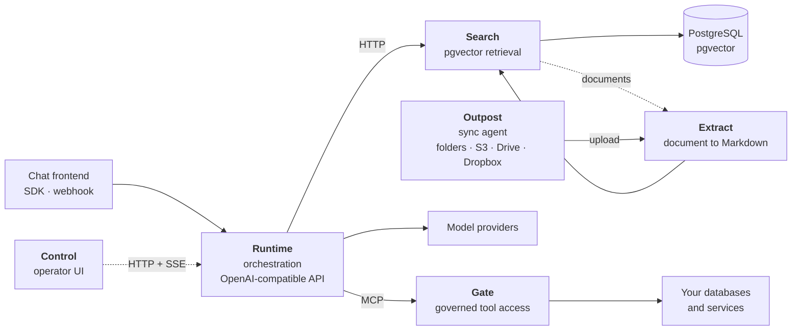
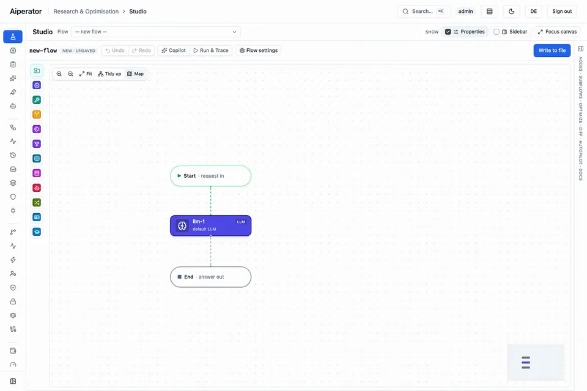

<h1 align="center">Aiperator Trust Fabric</h1>

<p align="center">
  <strong>Self-hosted AI orchestration you can put in front of an auditor.</strong>
</p>

<p align="center">
  <a href="https://github.com/abillify/atf/actions/workflows/ci.yml"></a>
  <a href="LICENSE"></a>
  <a href="CHANGELOG.md"></a>
  
  
  
  <a href="sbom.cdx.json"></a>
</p>

<p align="center">
  <a href="https://aiperator.dev">Website</a> ·
  <a href="ARCHITECTURE.md">Architecture</a> ·
  <a href="CHANGELOG.md">Changelog</a> ·
  <a href="LICENSING.md">Licensing</a>
</p>

---

ATF is a platform for building and operating AI assistants and agents on your own
infrastructure, where the interesting problem is not calling a model but everything around it:
keeping personal data out of a provider's hands, requiring a human to approve consequential
actions, proving to a regulator what happened, and knowing what it cost.

Seven applications, connected by explicit versioned contracts and open protocols. Each one is
deployable on its own. Five of them run as server services; the Extract Outpost runs on your
side — as a Docker daemon or a desktop app — and mirrors local folders and cloud storage into
the platform.

> **Project status:** ATF is at `0.20.0`: complete enough to evaluate the local service wiring
> end to end, but still pre-1.0. Governed capabilities require explicit configuration and
> verification for each deployment. Contract packages already carry compatibility guarantees;
> flow fields, environment variables, and HTTP routes may still change with documented
> migrations. See [docs/STABILITY.md](docs/STABILITY.md) for what is covered from 1.0.0.

ATF grew out of production engineering for regulated environments, where audit evidence,
identity, data residency, and approval controls are deployment requirements rather than roadmap
items. This public repository contains the reusable platform only — no customer configuration,
credentials, or environment-specific operations material.

## Why this exists

Most AI platforms are either a hosted SaaS, which means your data leaves the building, or a
toolkit, which means you build governance yourself. ATF is production plumbing for the case
where neither is acceptable: run it on-premises or in your own cloud, connect it to systems you
already have, and get cost, access, and quality measurable from the first request.

Concretely, ATF is opinionated about four things most orchestrators leave to you:

**Tokenize detected personal data before provider calls.** When the PII vault is enabled and its
detectors are configured for the deployment, it replaces detected values with meaningless
placeholders before a provider call and restores them in the response. A fail-closed detector
mode and an explicit multimodal policy are required when those guarantees matter; the feature is
off in the unauthenticated local quickstart. See
[Privacy and the PII vault](docs/CAPABILITIES.md#privacy-and-the-pii-vault) for the boundaries.

**A human decides what matters.** When approval controls are enabled for a consequential tool,
the call pauses and waits for approval in the chat message or reviewer inbox. If nobody answers
within the timeout, the action is **rejected**. Silence never becomes an action.

**Compliance is evidence, not assertion.** When configured, the audit log is hash-chained and
anchored, evidence bundles are signed, and a generated dossier collects the active policy, the
chain verification result, executed erasures, retention windows, evaluation results, and the
red-team posture score.

**Production gates reject selected unsafe settings.** With the production profile
(`ATF_PROFILE=production`; without it the service variable, e.g. `APP_ENV=production` for
Runtime, `MCPGATE_ENV` for the Gate, `NODE_ENV` for Search and Extract), Runtime refuses
to start on configurations such as open CORS, unverified JWTs, or an unauthenticated metrics
endpoint. Individual guardrails and policies remain explicit deployment choices; their defaults
and prerequisites are documented in [Capabilities](docs/CAPABILITIES.md) and
[Configuration](docs/CONFIGURATION.md).

### What ATF is not

It is not a hosted service — there is no signup, and operating it for third parties is the one
use the license reserves. It is not a research or agent-authoring framework; flows are YAML
that operators review, not a Python DSL. And it is not a thin proxy in front of a model API:
the retrieval, policy, and evidence layers are the product, which is also why the server
deployment footprint is PostgreSQL plus five services rather than a single binary (the Outpost
sync agent runs on the customer side, not in that footprint).

### When to use something else

ATF optimizes for governed operation, not for winning every orchestration use case:

| If your primary need is… | Start with… |
| --- | --- |
| Fast Python experiments and custom agent research | A code-first agent SDK such as LangGraph |
| Visual business automation across SaaS tools | n8n, Flowise, or Dify |
| A hosted model gateway with no infrastructure to operate | A managed AI platform |
| Self-hosted assistants with policy, approvals, evidence, tenant isolation, and cost controls as one runtime | **ATF** |

The point is not to replace those tools. ATF is the operational boundary you choose when the
answer to “who approved this, what data left the system, and can we prove it?” must come from the
platform rather than application-specific glue.

## Architecture



| Application | Role |
| --- | --- |
| [`apps/runtime`](apps/runtime) | Executes flow graphs, enforces policy, guardrails, approvals, and the PII vault. Serves an OpenAI-compatible API |
| [`apps/control`](apps/control) | Operator and governance UI. Uses Runtime's HTTP API and SSE stream; deployment routing remains external |
| [`apps/search`](apps/search) | Semantic and hybrid retrieval on PostgreSQL/pgvector. No separate vector database |
| [`apps/gate`](apps/gate) | MCP gateway. Turns YAML into governed, identity-aware tools |
| [`apps/extract`](apps/extract) | Converts PDF, office and image documents into the canonical extracted-document Markdown that Search indexes |
| [`apps/outpost`](apps/outpost) | Extract Outpost runtime: a locally-operated sync agent (CLI daemon, Docker entrypoint, health endpoint) that mirrors folders, S3, Google Drive and Dropbox into Extract collections |
| [`apps/outpost-desktop`](apps/outpost-desktop) | Desktop wrapper around the same sync core for users who run the Outpost on their own machine |

The platform is organised as seven applications under [`apps/`](apps), twelve shared packages under
[`packages/`](packages) — versioned contract packages plus `security-kit`, `observability`,
`outpost-core`, `canonical-json` and `mcp-2026` — and one end-to-end suite in [`integration/`](integration). `integration/system`
exercises their combined lifecycle so a contract break fails in CI rather than at deployment. See
[ARCHITECTURE.md](ARCHITECTURE.md) for the request path and the design rules.

## Control at a glance

Control makes the operational surface visible instead of hiding it behind configuration files:
flow authoring and diffs, live graph execution, traces, approvals, evaluation runs, canaries,
security posture, providers, budgets, and compliance evidence share one operator UI.

<p align="center">
  <a href="docs/media/studio-demo.webm"></a>
</p>
<p align="center"><em>A Studio test run of <a href="deploy/examples/flows/06-request-pipeline.yaml"><code>06-request-pipeline.yaml</code></a> against a deterministic mock model: the answer streams in, then the canvas shows the traced path through the graph. The image loops; the link opens the <a href="docs/media/studio-demo.webm">WebM</a>.</em></p>

<p align="center">
  
</p>
<p align="center"><em>Control desktop navigation; this image is also maintained as a visual-regression snapshot.</em></p>

## Quickstart

Requirements: Docker with Compose v2, roughly 6 GB free memory and 10 GB disk for the build.

```bash
git clone https://github.com/abillify/atf.git && cd atf
docker compose --env-file deploy/examples/.env.example -f deploy/examples/compose.yaml up --build -d
```

This starts all five applications plus PostgreSQL/pgvector and a deterministic mock model, so
it needs no API key. Once the health checks pass:

- Control — <http://localhost:3001>
- Runtime readiness — <http://localhost:3000/health/ready>
- Search health — <http://localhost:3002/health>
- Gate readiness — <http://localhost:3003/readyz>
- Extract health — <http://localhost:3004/health>

Run a flow through the OpenAI-compatible endpoint:

```bash
curl --fail-with-body http://localhost:3000/v1/chat/completions \
  -H 'Content-Type: application/json' \
  -d '{"model":"quickstart","messages":[{"role":"user","content":"Confirm the quickstart."}]}'
```

> **This stack is unauthenticated on purpose.** It is for local functional testing and is not a
> production template. Do not expose it. See
> [deploy/examples/README.md](deploy/examples/README.md).

Example flows in [`deploy/examples/flows/`](deploy/examples/flows/) go from a single node up to
retrieval, tool use with an approval gate, and a routed multi-step graph.

## Flows

A flow is a YAML graph, validated on load and hot-reloaded without a restart. It is
reviewable and versionable like source code.

```yaml
id: support-assistant
name: Support Assistant
metadata:
  version: 1.2.0
dataClasses: [personal]

nodes:
  - id: classify
    type: classifier
    classifierSchema:
      classKey: intent
      schema:
        type: object
        properties:
          intent: { type: string, enum: [question, action] }
        required: [intent]

  - id: answer
    type: retrieval
    config: { collection: handbook, topK: 6 }

  - id: act
    type: llm
    tools: [gate:ticket_create]

edges:
  - { source: classify, target: answer, conditions: "classification.intent == 'question'" }
  - { source: classify, target: act, conditions: "classification.intent == 'action'" }
```

This exact flow is checked in as
[`deploy/examples/flows/05-support-assistant.yaml`](deploy/examples/flows/05-support-assistant.yaml)
and validated by CI, so the README cannot silently drift away from the executable schema.

Node types: `llm`, `tool`, `router`, `classifier`, `parallel`, `retrieval`, `memory`,
`agent-harness`, `transform`, `trigger`, `assistant-context`, `assistant-learn`, plus any
plugin-provided type.

## What's in the box

One line each; [docs/CAPABILITIES.md](docs/CAPABILITIES.md) has every capability and the
setting that governs it.

- **Models** — cloud and local providers side by side, as named instances validated at startup
  and selectable per node.
- **Retrieval** — hybrid dense plus full-text on pgvector, RRF-fused and reranked, with
  embedding-revision drift protection.
- **Document intelligence** — a resumable, contract-versioned ingestion path (Document
  Intelligence v2) that turns PDF, office and image documents up to 10 000 pages into a
  multi-level index (chunk, table, figure, section, page, document) with contextual embedding
  headers, identifier-aware RRF, rerank-with-context, small-to-big expansion, transcribed
  visual content (BPMN, masks, plans, charts) and per-figure assets, feeding a RAG node that
  can attach or `inspect_image` on demand. See the
  [migration guide](docs/document-intelligence-v2-migration.md).
- **Tool access** — MCP tools declared in YAML over SQL, HTTP, MQTT, MCP proxy, and webhooks.
  Parameters are bound, never interpolated.
- **Channels** — an OpenAI-compatible API, webhooks, and a Rocket.Chat integration with
  per-user OIDC consent.
- **Safety** — guardrails on input and output, egress DLP, tool *output* checked for injected
  instructions, scheduled red teaming, sandboxed plugins.
- **Governance** — approvals that reject on timeout, an explicitly loaded
  `compliance-policy.yaml`, hash-chained audit records, signed evidence bundles, and a generated
  dossier when their required controls are configured.
- **Quality** — datasets with judge scoring, canary promotion, replay, and shadow mode that
  measures a candidate against real traffic without ever showing a user a worse answer.
- **Cost** — objective-driven routing, fallback chains with circuit breakers, three cache
  layers, hard per-tenant budgets, FinOps forecasting with CO2 accounting.
- **Operations** — application-scoped multi-tenancy with optional PostgreSQL row-level-security
  hardening, BYOK, OIDC and RBAC, OpenTelemetry and Prometheus, per-execution debug traces, and
  optional durable execution.

## Verification

Every artefact the platform issues — decision receipts, signed evidence
bundles, Ed25519 erasure receipts, audit-log exports with anchors — can be
verified offline with `atf-verify`, without trusting or contacting the issuing
instance. Each GitHub release ships a standalone binary for Linux (x64 and
arm64), macOS (x64 and arm64) and Windows (x64, `.exe`)
(`atf-verify-<platform>`); in a source checkout the same tool runs as
`bun run scripts/atf-verify.ts`. Public keys come from the instance's JWKS
(fetched once or from a saved file); the artefact's own `kid` selects the key.

```bash
atf-verify --receipt <file> --jwks <url|file> [--proof <file>]   # decision receipt (+ Merkle proof)
atf-verify --bundle <file> --jwks <url|file>                     # signed evidence bundle
atf-verify --erasure-receipt <file> --jwks <url|file>            # erasure receipt
atf-verify --audit-export <file> [--anchor <file>]               # audit log (+ anchors)
atf-verify --release-receipt <file> --jwks <url|file>          # flow release receipt
```

Exit codes: `0` verified, `1` verification failed, `2` usage or input error.
Legacy HMAC artefacts verify with `--secret` via
`bun run scripts/cli.ts verify-bundle` in `apps/runtime`. See
[ADR 0030](docs/adr/0030-asymmetric-evidence-chain-ed25519.md) for the
verification design.

Releases publish multi-arch service images (`linux/amd64`, `linux/arm64`) to
`ghcr.io/abillify/atf-<service>` and the Helm chart to
`oci://ghcr.io/abillify/charts/atf`, both cosign-signed. Install and verify them
with the commands in [DEPLOYMENT.md](DEPLOYMENT.md); if a pull fails with
`denied` or `not found`, the package is not public yet — build from source or
ask the maintainers.

Before starting a service, `bun run atf-doctor --service runtime|search|extract --env-file <file>`
checks its environment file against the production gates and the governance posture offline —
see [Preflight with atf-doctor](DEPLOYMENT.md#preflight-with-atf-doctor).

## Development

```bash
bun install --frozen-lockfile
bun run typecheck
bun run test
bun run build
```

Bun 1.4.0 is the only package manager and task runner; npm, pnpm, and yarn are not supported.
Node.js 26 is the supported Node major. Target one workspace with
`bun run --filter @atf/runtime test`.

The full list of gates CI runs is in [DEVELOPMENT.md](DEVELOPMENT.md#the-gates).

See [DEVELOPMENT.md](DEVELOPMENT.md) and [CONTRIBUTING.md](CONTRIBUTING.md).

## Documentation

| Document | Contents |
| --- | --- |
| [ARCHITECTURE.md](ARCHITECTURE.md) | Applications, contracts, request path, design rules |
| [docs/CAPABILITIES.md](docs/CAPABILITIES.md) | Every capability and the settings that govern it |
| [docs/CONFIGURATION.md](docs/CONFIGURATION.md) | Generated configuration reference; the current count is recorded in that generated file |
| [docs/CONFIGURATION-ESSENTIALS.md](docs/CONFIGURATION-ESSENTIALS.md) | The variables a first production deployment needs, per service |
| [DEPLOYMENT.md](DEPLOYMENT.md) | Production requirements and the supported boundary |
| [DEVELOPMENT.md](DEVELOPMENT.md) | Toolchain and workflow |
| [CHANGELOG.md](CHANGELOG.md) | Notable changes, and what is versioned independently of it |
| [docs/adr/](docs/adr/) | Architecture decisions with their trade-offs |
| [docs/document-intelligence-v2-migration.md](docs/document-intelligence-v2-migration.md) | Document Intelligence v2 upgrade, rollback, and corpus re-ingest |
| [SECURITY.md](SECURITY.md) | Reporting a vulnerability, response targets, scope |
| [docs/README.md](docs/README.md) | Index of all documentation |
| [docs/UPGRADE.md](docs/UPGRADE.md) | Upgrading a deployment, milestone by milestone |
| [docs/STABILITY.md](docs/STABILITY.md) | Stability contract: what semantic versioning covers from 1.0.0 |
| [docs/THREAT-MODEL.md](docs/THREAT-MODEL.md) | STRIDE threat model per service |
| [docs/EU-AI-ACT.md](docs/EU-AI-ACT.md) | EU AI Act obligations mapped to ATF controls |
| [docs/runbooks/](docs/runbooks/) | Backup, key rotation, incidents, scaling, Redis outage, transaction-token rotation |

## Enterprise adoption and engineering

[Abillify](https://abillify.me), the team behind ATF, helps organisations build, integrate,
and operate audit-ready AI platforms on ATF: architecture and deployment design, integration
with identity providers and existing systems, governance and compliance evidence, custom node
types and Gate tools, and enterprise support for production operation. Engagements are
separate from the license; commercial licensing is covered in [LICENSING.md](LICENSING.md).
Product overview and demos: [aiperator.dev](https://aiperator.dev).

## License

ATF is source-available under the [Elastic License 2.0](LICENSE). Run it, modify it,
self-host it, embed it in your product, redistribute it. The one reserved use is offering ATF
itself to third parties as a hosted or managed service.

**ATF is not open source** under the OSI definition, and we do not describe it as such. The
rights matrix and the commercial licensing path are in [LICENSING.md](LICENSING.md).

Third-party dependencies remain under their own licenses. The committed
[THIRD_PARTY_NOTICES.md](THIRD_PARTY_NOTICES.md) and CycloneDX
[sbom.cdx.json](sbom.cdx.json) are the byte-stable Linux x64 workspace reference. CI also
publishes commit-specific native macOS/Linux workspace inventories and inventories extracted
from each final Quickstart image; those image inventories describe the repository Quickstart,
not independently built production images. Every component must have complete license/notice
text, and LGPL/MPL/CC-BY duties are called out per artifact. Trademark terms are separate from
the code license; see [TRADEMARKS.md](TRADEMARKS.md).

Copyright © 2026 Abillify Technology GmbH. Authorship in [AUTHORS.md](AUTHORS.md).
Consulting, integration and enterprise support: [abillify.me](https://abillify.me).
